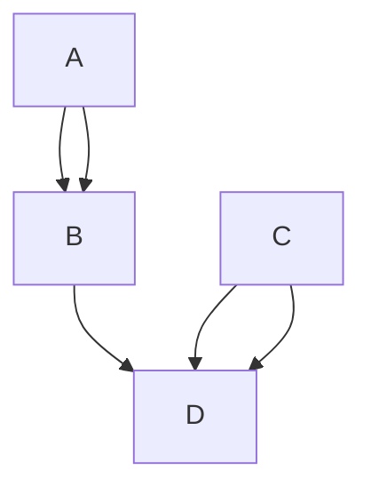

# title

## Section

### Subsection

```diff
javascript

- console.log("hello")
+ console.log("Hello")

```
<!--markdownlint-disable-->
<details>
<summary>サンプルコード</summary>

```js
console.log("hello")
```

```py
print("hello")
```
</details>
<!--markdownlint-enable-->

 This is *italic type*.

 This is **太字**.

<!--markdownlint-disable-->
> [!NOTE]
> インフォメーション

> [!TIP]
> 役立つヒント

> [!IMPORTANT]
> 重要な情報

> [!WARNING]
> ○○に注意してください。

> [!CAUTION]
> ○○しないでください。
<!--markdownlint-enable-->

3\. リスト
エスケープされています

* list

* list
  
* list

[maruweb factory](https://www.maruwebfactoryjapan.com/)

* [x] todo
* [ ] todo
* [ ] todo
<!--markdownlint-disable-->
* * *
---
- - -
***
<!--markdownlint-enable-->
| Left align | Right align | Center align |
| :--------- | ----------: | :----------: |
| This       |        This |     This     |
| column     |      column |    column    |
| will       |        will |     will     |
| be         |          be |      be      |
| left       |       right |    center    |
| aligned    |     aligned |   aligned    |

```mermaid
architecture-beta
    service user(mdi:account)
    service lambda(logos:aws-lambda)

    user:R --> L:lambda
```





```md
your-monorepo/
├── CLAUDE.md                    # 全体ルール（共通）
├── packages/
│   ├── backend/
│   │   ├── CLAUDE.md            # バックエンド固有ル
│   │   └── src/
│   └── frontend/
│       ├── CLAUDE.md            # フロントエンド固有
│       └── src/
```
